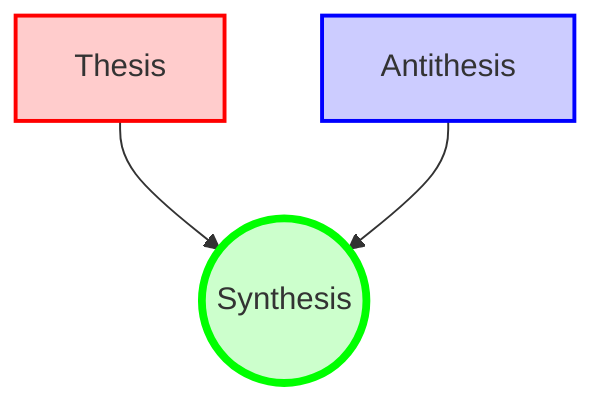
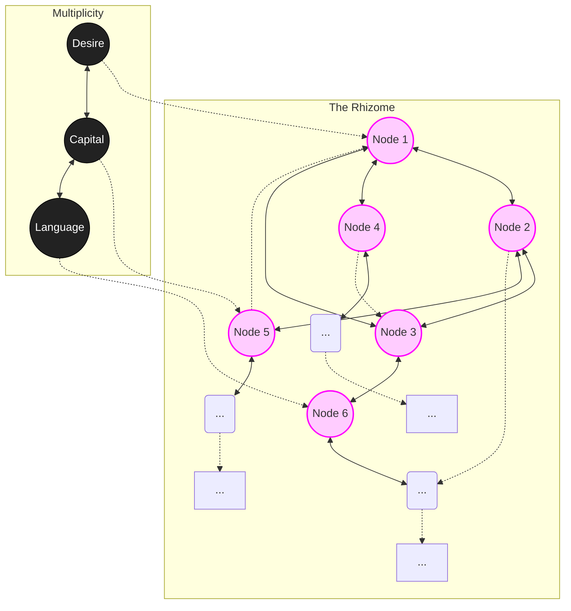

# Structural Topologies: Hegel vs. Deleuze

> **The Sweetbrier Thesis:** If you can conceptualize the causal flowchart of a problem—even if that flowchart is an infinitely expanding rhizome—you can solve it by vibe-coding (Agentic FCoT verification) hard enough.

---

### 1. Hegel's Cathedral: `TREE(2) = 3`
The Hegelian dialectic assumes that history and truth resolve cleanly. It is a finite, closed loop. Two opposing forces meet and resolve into a single, unified synthesis. Mathematically, it is a graph of exactly 3 nodes. It is highly legible, but structurally fragile.

 

### 2. Deleuze's Rhizome: `SSCG(3) = 💥`
Deleuze recognized that the moment you introduce actual multiplicity to a system, it cannot resolve into a neat triangle. The synthesis of three elements explodes into an unimaginably massive, non-hierarchical web where any point can connect to any other point. It fundamentally breaks the capacity of a standard flowchart—which is exactly why the Universal Verification Engine uses Causal DAGs to map it dynamically.

> *"A rhizome has no beginning or end; it is always in the middle, between things, interbeing, intermezzo." — A Thousand Plateaus*
